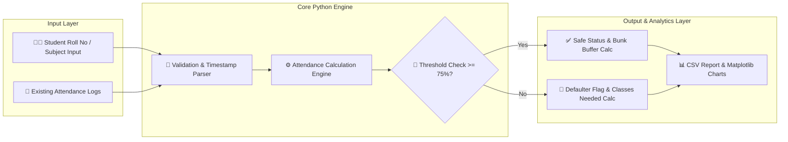

<div align="center">
  
</div>
 
  # 📊 Attendance Tracker Python
  ### *A Lightweight, Automated Python Pipeline for Attendance Management, Threshold Analytics & Reporting*

  <!-- Dynamic Shields.io Badges Linked Directly to AVK48/attendance-tracker-python -->
  <p align="center">
    <a href="https://github.com/AVK48/attendance-tracker-python/stargazers">
      
    </a>
    <a href="https://github.com/AVK48/attendance-tracker-python/network/members">
      
    </a>
    <a href="https://github.com/AVK48/attendance-tracker-python/commits/main">
      
    </a>
    
  </p>

  <!-- Tech Stack Badges -->
  <p align="center">
    
    
    
    
    
  </p>

  <h4>
    <a href="#-key-features">Key Features</a> •
    <a href="#-pipeline--system-architecture">Pipeline Architecture</a> •
    <a href="#-mathematical-logic--threshold-engine">Math Logic</a> •
    <a href="#-installation--usage">Quick Start</a>
  </h4>
</div>

---

## 📌 Table of Contents
- [🎯 Overview & Problem Statement](#-overview--problem-statement)
- [✨ Key Features](#-key-features)
- [🏗️ Pipeline & System Architecture](#️-pipeline--system-architecture)
- [🧮 Mathematical Logic & Threshold Engine](#-mathematical-logic--threshold-engine)
- [📸 Visual Output & Reports](#-visual-output--reports)
- [📁 Project Directory Structure](#-project-directory-structure)
- [⚙️ Installation & Usage](#️-installation--usage)
- [🔮 Future Enhancements](#-future-enhancements)
- [👨‍💻 Author](#-author)

---

## 🎯 Overview & Problem Statement
Managing student or member attendance manually across spreadsheets often leads to **data entry errors, delayed defaulter identification, and tedious percentage calculations**. Students also struggle to track how many classes they need to attend to maintain mandatory institutional thresholds (such as the standard **75% attendance requirement**) or how many classes they can safely miss.

**`attendance-tracker-python`** solves this by providing a clean, modular Python pipeline that:
1. Automates daily/session attendance logging with timestamp validation.
2. Calculates real-time attendance percentages across subjects or events.
3. Flags low-attendance defaulters and computes actionable recovery targets.
4. Exports structured summary reports (`.csv` / `.xlsx`) and visual charts.

---

## ✨ Key Features
- 📝 **Seamless Attendance Logging:** Fast CLI / GUI / script-based check-in using Roll Numbers / Hall Ticket IDs with automatic duplicate-entry prevention.
- 📈 **Real-Time Percentage & Buffer Calculator:** Instantly tells a student or administrator whether an individual is in the **Safe Zone ($\ge 75\%$)**, **Warning Zone ($65\% - 74.9\%$)**, or **Shortage/Detention Zone ($< 65\%$)**.
- 🚨 **Automated Defaulter Filtering:** Generates filtered lists of students falling below the target threshold for immediate faculty or coordinator action.
- 📊 **Data Visualization & Export:** Converts raw attendance logs into clean Pandas DataFrames, exporting summary CSVs and visual bar/trend charts.
- 🛡️ **Persistent Local Storage:** Uses structured CSV/SQLite storage so zero external cloud configuration is required to run out-of-the-box.

---

## 🏗️ Pipeline & System Architecture
The internal execution pipeline processes raw attendance inputs into actionable analytics in four stages (rendered natively via GitHub Mermaid):



---

## 🧮 Mathematical Logic & Threshold Engine
At the heart of the tracker is a predictive calculation module that computes not just current attendance, but **future class requirements**:

1. **Current Attendance Percentage ($P$):**
   $$P = \left( \frac{A}{T} \right) \times 100$$
   *Where $A$ = Classes Attended, $T$ = Total Classes Conducted.*

2. **Classes Required to Reach Target Threshold ($R$, where Target $T_{req} = 0.75$):**
   If $P < 75\%$, the exact number of consecutive classes a student must attend to hit $75\%$ is calculated as:
   $$R = \left\lceil \frac{0.75 \cdot T - A}{1 - 0.75} \right\rceil = \lceil 3T - 4A \rceil$$

3. **Safe Margin / Classes Can Miss ($M$):**
   If $P \ge 75\%$, the number of classes a student can miss while staying above $75\%$ is:
   $$M = \left\lfloor \frac{A - 0.75 \cdot T}{0.75} \right\rfloor = \left\lfloor \frac{4A - 3T}{3} \right\rfloor$$

---

## 📸 Visual Output & Reports

### 🖥️ Sample CLI / Console Execution
```text
======================================================================
               📊 PYTHON ATTENDANCE TRACKER & ANALYZER                
======================================================================
Roll No      | Subject        | Attended | Total | Percentage | Status
----------------------------------------------------------------------
23UK1A6748   | Data Science   | 34       | 40    | 85.00%     | 🟢 SAFE (Can miss 5)
23UK1A6701   | Machine Learn. | 28       | 40    | 70.00%     | 🔴 SHORTAGE (Attend next 8)
23UK1A6712   | Python Prog.   | 30       | 40    | 75.00%     | 🟡 ON EDGE (Can miss 0)
======================================================================
[✔] Report successfully exported to: ./reports/attendance_summary.csv
```

### 📈 Analytics Previews
*(Replace the placeholder links below with actual screenshots from your repository once uploaded to an `assets/` folder)*

| 📊 Subject-Wise Attendance Distribution | 📋 Exported CSV / Dashboard View |
| :---: | :---: |
|  | =75%)','Warning%20(65-75%)','Shortage%20(<65%)'],datasets:[{data:[72,18,10],backgroundColor:['%232ecc71','%23f1c40f','%23e74c3c']}]}}" width="100%" alt="Status Breakdown Chart" /> |
| *Automated subject-wise percentage chart* | *Overall class compliance breakdown* |

> 💡 **Pro Tip:** The charts above use live QuickChart URLs so they render real graphics immediately in your README before you even upload local images!

---

## 📁 Project Directory Structure

```text
attendance-tracker-python/
├── 📂 data/
│   ├── attendance_log.csv       # Raw timestamped attendance records
│   └── students.csv             # Master student / subject roster
├── 📂 reports/
│   └── attendance_summary.csv   # Generated analytical reports
├── 📂 src/                      # (Or root scripts)
│   ├── tracker.py               # Core attendance logging & CRUD functions
│   ├── analytics.py             # Percentage, buffer & defaulter math engine
│   └── visualizer.py            # Matplotlib / Seaborn chart generator
├── main.py                      # Main application entry point
├── requirements.txt             # Required Python dependencies
└── README.md                    # Project documentation
```

---

## ⚙️ Installation & Usage

### 1. Clone the Repository
```bash
git clone [https://github.com/AVK48/attendance-tracker-python.git](https://github.com/AVK48/attendance-tracker-python.git)
cd attendance-tracker-python
```

### 2. Set Up Virtual Environment & Dependencies
```bash
# Create a virtual environment
python -m venv venv

# Activate on Windows (VS Code / PowerShell)
venv\Scripts\activate

# Activate on Linux / macOS
source venv/bin/activate

# Install dependencies (if applicable)
pip install -r requirements.txt
```

### 3. Run the Tracker
```bash
python main.py
```

---

## 🔮 Future Enhancements
- [ ] **Automated Telegram / Email Alerts:** Integrate with Telegram Bot API or SMTP to automatically notify students when their attendance drops below 75%.
- [ ] **Streamlit / Flask Web Dashboard:** Upgrade the interface into an interactive web app with student login portals.
- [ ] **QR Code / OpenCV Check-In:** Add webcam QR code scanning or facial recognition for contactless classroom attendance marking.

---

## 👨‍💻 Author

**Aennam Vinay Kumar**  
*B.Tech in CSE (Data Science) — Vaagdevi Engineering College*  
*Chair, IEEE Student Branch VEC*

<p align="left">
  <a href="https://github.com/AVK48">
    
  </a>
  <a href="https://linkedin.com/in/aennamvinaykumar">
    
  </a>
</p>

---
<div align="center">
  <i>If this project helped you manage your attendance or learn Python automation, drop a ⭐ on the repository!</i>
</div>
